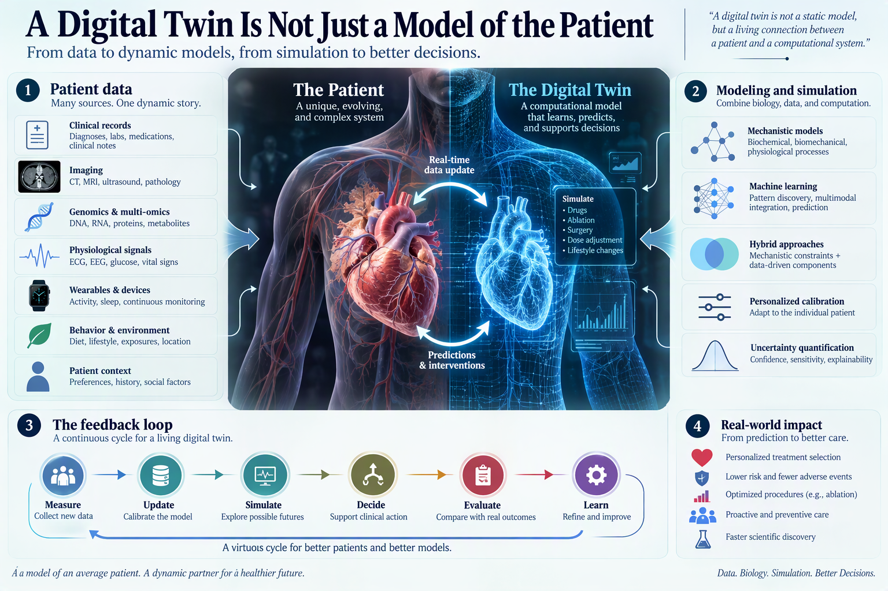

## A model becomes a twin only when it stays connected
  

Healthcare has no shortage of patient models. Risk scores estimate mortality. Neural networks classify scans. Pharmacokinetic models predict drug concentrations. Anatomical reconstructions reproduce organs in three dimensions.
  

These tools may be clinically useful, but they are not automatically digital twins.
  

A digital twin requires three elements: a physical patient, a computational representation, and a continuing flow of information between them. The model receives new measurements, updates its internal state, simulates possible futures, and returns information that can change what happens to the patient next.
  

The feedback loop is the defining feature:

**Patient → Measurement → Model update → Simulation → Decision → New patient state**
  

Without this loop, the system is a static model. Without patient-specific calibration, it is a population model. Without intervention simulation, it is a forecasting tool. Calling every predictive algorithm a digital twin weakens the concept until it means almost nothing.
  

## Prediction is not the difficult part
  

Modern machine learning can predict disease labels, segment tumors, forecast laboratory values, and classify physiological signals with impressive accuracy. But a digital twin must answer a harder question:
  

> What is likely to happen to this patient if we intervene?
  

That shift from prediction to intervention is fundamental. A model that predicts atrial fibrillation recurrence describes risk. A digital heart should compare antiarrhythmic drugs, ablation targets, or dosing strategies within the same patient-specific electrophysiological system.
  

This distinction is already visible in cardiac applications. Patient-specific virtual drug testing has been associated with lower atrial fibrillation recurrence, with recurrence rates of 40.9% under digital-twin-guided treatment compared with 54.1% under conventional selection. Virtual amiodarone testing further separated patients into groups with recurrence rates of 20.8% and 45.1%, suggesting that simulated response can become more useful than static risk alone.
  

A digital twin is therefore not valuable because it predicts the future accurately. It is valuable because it compares multiple futures before one becomes irreversible.
  

## The twin must represent the right biology
  

No computational model can reproduce every molecule, cell, organ, and environmental exposure in a human body. Nor should it try.
  

The useful question is not whether the twin is complete. It is whether it represents the mechanisms that determine the clinical decision.
  

A cardiac twin may require anatomy, fibrosis, ion-channel conductance, electrical propagation, and hemodynamics. A diabetes twin may require glucose dynamics, insulin sensitivity, diet, exercise, and medication history. A cancer twin may require tumor growth, vascular transport, immune surveillance, drug penetration, and resistance evolution.
  

*A digital twin combines patient data, computational modeling, and a continuous feedback loop.*

Different decisions demand different resolutions. Surgical planning may depend heavily on anatomy and tissue mechanics. Drug selection may require pathway activity and pharmacodynamics. Long-term disease forecasting may require behavioral, environmental, and longitudinal clinical information.
  

This makes digital twins purpose-built systems rather than universal replicas. A model can be highly accurate for one intervention and dangerously incomplete for another.
  

## Digital twins exist across biological scales
  

Digital twins are often imagined as complete virtual patients. In practice, the most credible systems are narrower and operate at specific physiological levels.
  

At the molecular level, computational models estimate drug binding, transport, metabolism, and toxicity. At the cellular level, perturbation models forecast responses to drugs, gene knockouts, or metabolic changes. Tissue models simulate cell-cell interactions, diffusion, immune surveillance, and mechanical stress. Organ twins reproduce cardiac electrophysiology, pulmonary mechanics, hepatic metabolism, or brain degeneration. Whole-patient systems attempt to integrate these layers with clinical history, imaging, electronic health records, and continuous sensor data.
  

The hierarchy is useful, but it should not be mistaken for a simple assembly line. A virtual cell does not automatically scale into a virtual tissue, and a collection of virtual organs does not automatically become a patient. Biological processes interact across scales and frequently violate clean computational boundaries.
  

The strongest systems therefore combine multiple modeling strategies rather than forcing every phenomenon into one architecture.
  

## Mechanistic models and AI solve different problems
  

Physics-based and mechanistic models represent known relationships explicitly. Ordinary differential equations can describe pharmacokinetics, metabolic exchange, or disease dynamics. Partial differential equations can represent diffusion, tissue transport, and spatial propagation. Agent-based models can simulate individual cells and their interactions. Hybrid discrete-continuum systems can model cells as agents while treating oxygen, nutrients, and drugs as continuous concentration fields.
  

These models are interpretable and can remain useful when data are limited. Their weakness is that biological systems contain unknown mechanisms, uncertain parameters, and interactions too complex to encode manually.
  

Machine learning solves a different problem. Neural networks, transformers, graph models, and ensemble methods can learn nonlinear relationships from imaging, omics, electronic health records, and sensor streams. They scale better to high-dimensional data, but may learn associations that fail under new interventions.
  

A clinically credible digital twin should combine both strengths:

- **Mechanistic constraints** preserve biological and physical plausibility.
- **Machine learning** captures patterns not represented by explicit equations.
- **Bayesian calibration** updates patient-specific parameters from new observations.
- **Uncertainty quantification** distinguishes robust predictions from extrapolation.
- **Control and optimization methods** identify which intervention is expected to produce the best outcome.
  

The future is not purely mechanistic or purely data-driven. It is hybrid.
  

## Evidence is strongest where the system is constrained
  

The most convincing applications occur when the physiological system, intervention, and outcome are clearly defined.
  

### Cardiology
  

Cardiac digital twins can combine imaging, electrocardiography, tissue structure, ion-channel biology, and electrophysiological simulation. Large-scale work has constructed 3,461 cardiac twins from population data, revealing how anatomy, age, obesity, and sex contribute to electrophysiological variation.
  

Patient-specific digital hearts have also reduced simulated ablation volumes from 7.05 cm³ in clinical procedures to 1.87 cm³ while maintaining 79% overlap with actual treatment targets. This is a useful twin because its output corresponds to an intervention: where to ablate.
  

### Diabetes
  

Glucose regulation is especially suitable for digital twinning because glucose, insulin, food intake, exercise, and medication can be repeatedly measured. An exercise decision-support system for type 1 diabetes increased time within the target glucose range from 80.2% to 92.3% during aerobic activity and reduced hypoglycemia from 15.1% to 5.1%.
  

The significance is not merely predictive accuracy. The model converts real-time physiology into a recommendation before an adverse event occurs.
  

### Oncology
  

Cancer digital twins are harder because tumors evolve, compete for resources, interact with immune cells, and develop resistance. Useful cancer twins must therefore model treatment as a dynamic process rather than a one-time molecular match.
  

In high-grade glioma simulations, patient-specific radiotherapy optimization achieved either improved tumor control or a median radiation-dose reduction of 16.7% while maintaining equivalent outcomes. In head and neck cancer, deep reinforcement learning improved simulated survival by 3.73% while modestly reducing dysphagia.
  

These results are promising, but they also expose the central challenge: an optimized result in a virtual cohort is not yet evidence of clinical benefit in real patients.
  

### Cellular systems
  

At the cellular level, digital twins can learn how gene expression or protein activity changes after drug treatment, gene knockout, or metabolic perturbation. Resources such as LINCS contain measurements across more than 25,000 perturbations and 71 cell lines, yet only a fraction of all possible cell-line and intervention combinations have been tested.
  

Models such as CellBox, Bicycle, GEARS, scGen, CPA, and scGPT attempt to predict the missing responses using differential equations, causal representations, graph neural networks, variational autoencoders, or foundation-model architectures.
  

These models accelerate hypothesis generation, but predicting a transcriptional profile is not the same as reproducing a cell. A credible cellular twin must eventually connect molecular response to phenotype, timing, dose, adaptation, and failure.
  

## Real-time updating is not optional
  

A patient changes. Tumors evolve. Drug sensitivity shifts. Organs remodel. Treatment alters the system being modeled.
  

A digital twin that is calibrated once and never updated becomes progressively less personal. Its state diverges from the physical patient.
  

Continuous synchronization may draw from:

- electronic health records;
- laboratory measurements;
- CT, MRI, ultrasound, and pathology images;
- wearable and implantable sensors;
- electrocardiography and electroencephalography;
- glucose monitors;
- genomic and multi-omic profiles;
- medication exposure;
- behavioral and environmental measurements.
  

Standards such as FHIR, HL7, and ISO/IEEE 11073 can support interoperability, while edge computing can process sensitive physiological data close to the patient. Apache Kafka and MQTT can manage high-velocity streams when continuous data exchange is required.
  

Yet more data do not guarantee a better twin. Data may be delayed, missing, biased, measured at incompatible resolutions, or generated by devices with different error profiles. Synchronization is therefore an inference problem, not simply a data-engineering task.
  

## Uncertainty is part of the twin
  

Healthcare digital twins often produce precise simulations from incomplete measurements. This creates a dangerous illusion: a detailed output can look more certain than the evidence supporting it.
  

Uncertainty enters at several levels:

- measurement error;
- missing patient history;
- uncertain model parameters;
- unobserved biological mechanisms;
- differences between training and deployment populations;
- stochastic disease evolution;
- structural assumptions embedded in the model.
  

A clinically responsible twin should not return one optimized treatment as if it were inevitable. It should return a distribution of plausible outcomes, identify which assumptions drive the recommendation, and state when available data cannot distinguish among alternatives.
  

The correct output may be:
  

> Treatment A is favored under most plausible parameter values, but the decision is sensitive to an unmeasured biomarker.
  

That statement is less dramatic than a single prediction, but far more useful.
  

## Validation is the real bottleneck
  

Retrospective fit is not sufficient. A twin may reproduce historical data while failing to predict what happens after a new treatment.
  

Credible validation should ask whether the system:

1. reproduces the patient's observed baseline state;
2. forecasts longitudinal changes;
3. predicts responses to withheld interventions;
4. remains calibrated across hospitals and populations;
5. identifies cases outside its validated domain;
6. improves decisions compared with standard care;
7. survives prospective clinical evaluation.
  

Verification and validation frameworks such as ASME V&V 40 are relevant because computational credibility must be assessed in relation to the model's intended use and the consequences of an incorrect result. Regulatory pathways for computational models and in silico evidence are emerging, but adaptive twins remain difficult because the model itself may change after deployment.
  

The validation standard must rise with clinical risk. A model used for education does not require the same evidence as a model selecting radiation dose, guiding ablation, or recommending a drug.
  

## A digital twin also creates a governance problem
  

A high-fidelity patient twin may combine genomic data, imaging, continuous sensor streams, behavior, medication history, and clinical records. It can become more sensitive than any single source from which it was constructed.
  

This creates questions that technical performance cannot answer:

- Who controls the twin?
- Can the patient inspect or delete it?
- Who is liable when the physical patient and digital model diverge?
- Can insurers or employers access its risk forecasts?
- How are historical biases prevented from becoming simulated futures?
- Who benefits when a twin generates commercially valuable discoveries?
  

Digital equity is equally important. A twin trained on wealthy, highly monitored populations may perform poorly for patients with sparse records, limited access to wearables, or underrepresentation in clinical datasets. More personalization for already well-represented populations can deepen rather than reduce health disparities.
  

A digital twin is therefore not only a computational object. It is also a clinical, regulatory, and political allocation of predictive power.
  

## The real definition
  

The term *digital twin* should be reserved for systems that satisfy a demanding standard.
  

A healthcare digital twin must be:

- **patient-specific**, rather than merely population-trained;
- **dynamic**, rather than calibrated once;
- **bidirectionally connected**, rather than passively descriptive;
- **intervention-aware**, rather than limited to risk prediction;
- **mechanistically constrained**, where relevant biology is known;
- **uncertainty-aware**, rather than uniformly confident;
- **prospectively validated**, rather than impressive only in retrospective data;
- **clinically actionable**, rather than technically sophisticated but operationally inert.
  

The value of a digital twin is not that it resembles the patient. The value lies in its ability to reveal which future is avoidable, which intervention is worth attempting, and which uncertainty still requires an experiment.
  

**A model describes the patient. A digital twin must change intelligently as the patient changes.**

## Source

- Khoshfekr Rudsari, H. et al. *Digital twins in healthcare: a comprehensive review and future directions*. Frontiers in Digital Health 7, 1633539 (2025). [Full text](https://pmc.ncbi.nlm.nih.gov/articles/PMC12671388/pdf/fdgth-07-1633539.pdf)
