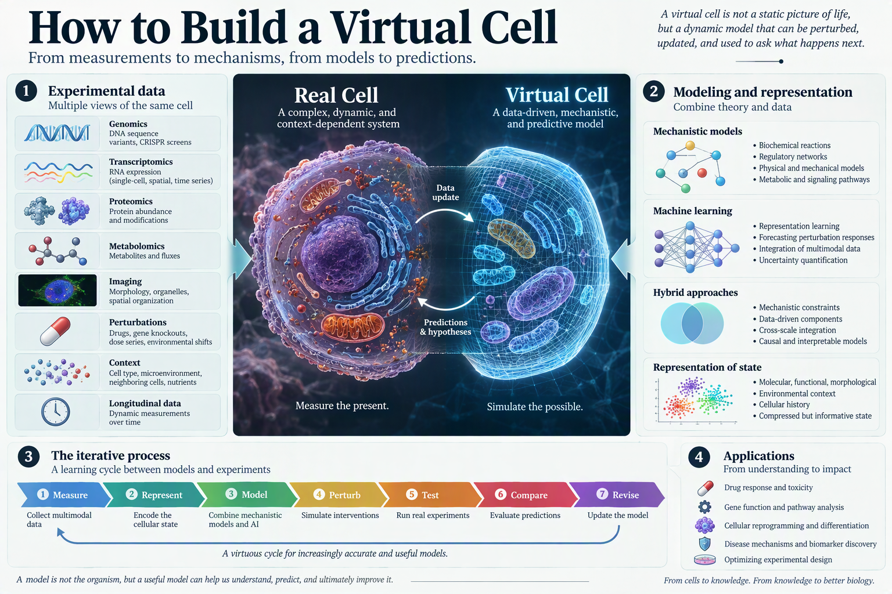

# How to Build a Virtual Cell

*A virtual cell should do more than reproduce measurements. It should provide a computational environment in which researchers can perturb genes, drugs, signaling pathways, or environmental conditions and predict what a real cell will do next.*

The phrase *virtual cell* suggests a complete digital replica of cellular life. That is an attractive vision, but it can also hide the scale of the scientific problem. A cell is not simply a list of expressed genes. It is a dynamic system in which molecular interactions, spatial organization, metabolism, mechanics, signaling, and environmental conditions jointly determine behavior.

A useful virtual cell therefore cannot be built from one dataset or one modeling paradigm. It requires experimental measurements, biological theory, mechanistic simulation, machine learning, and repeated comparison with real perturbation experiments. The goal is not to reproduce every molecule at every moment. The goal is to represent enough of the system to answer a clearly defined biological question.

## Where does a virtual cell fit in?

Cell biology already uses many forms of computational representation. Gene regulatory networks describe how genes influence one another. Metabolic models track the flow of material through biochemical reactions. Protein-structure models estimate molecular form and interaction. Single-cell foundation models learn statistical representations from large expression datasets. Mechanistic simulators encode explicitly defined biological rules.

Each of these systems captures part of cellular behavior, but none should automatically be treated as a complete virtual cell.

A virtual cell becomes scientifically useful when it connects cellular state to cellular response. Given an initial cell type, genotype, environment, and intervention, the model should estimate how the cell changes over time. Its output might include gene expression, signaling activity, morphology, metabolism, proliferation, differentiation, stress, or death.

This distinction separates a cellular atlas from a predictive model. An atlas describes what has been observed. A virtual cell must support *what-happens-when* experiments.

Researchers could use such a system to ask:

- What happens when a gene is deleted or overexpressed?
- How does a cell respond to a drug it did not encounter during training?
- Why does the same perturbation produce different outcomes across cell types or donors?
- Which molecular changes precede a phenotypic transition?
- Which experiment would best distinguish between competing biological mechanisms?

The answer does not need to include every molecular detail. It does need to be accurate enough for the intended decision.

## When will virtual cells be ready for use?

Some components of a virtual cell are already useful. Models can reconstruct molecular profiles, classify cell states, infer regulatory relationships, predict selected perturbation responses, and simulate specific biochemical or mechanical processes. These systems can guide experiments today when the biological scope and operating conditions are carefully defined.

A general-purpose virtual cell is a much longer-term project. Cellular behavior spans molecular events occurring in milliseconds, transcriptional programs evolving over hours, and population-level adaptation unfolding over days or longer. The relevant processes also operate across scales, from protein binding to organelle organization and communication among cells.

The practical route is therefore incremental. Researchers can first build constrained virtual cells for specific cell types, interventions, timescales, and outputs. A model of drug response in a cancer cell line and a model of differentiation in a stem cell need not use the same internal representation. They should be judged by whether they make reliable predictions within their declared domain.

The key question is not whether the model contains everything. It is whether the omitted biology changes the answer.

## What goes into building a virtual cell?

### Experimental data

A virtual cell must be grounded in measurements of real biological systems. Relevant inputs may include transcriptomics, proteomics, epigenomics, metabolomics, microscopy, lineage tracing, genetic screens, chemical perturbations, and measurements collected across time.

No single assay directly reveals the complete state of a cell. RNA abundance does not uniquely determine protein activity. A molecular profile may miss spatial organization. A static image may capture morphology without showing the causal sequence that produced it. Building a virtual cell therefore requires connecting complementary measurements rather than treating one modality as the cell itself.

*A virtual cell connects diverse measurements to models that can be tested and refined.*

Perturbation data are especially important. Observational datasets show which variables change together, but interventions help reveal which changes are causal. Gene knockouts, CRISPR interference or activation, drug treatments, dose series, and controlled environmental shifts can test whether the model has learned mechanisms or only correlations.

### A representation of cellular state

Before predicting the future of a cell, researchers must decide how to represent its present state.

A cellular state may include:

- molecular composition, including RNA, proteins, metabolites, and chromatin state;
- functional activity, such as proliferation, differentiation, secretion, or immune activation;
- morphology, including size, shape, organelle organization, and subcellular localization;
- environmental context, such as nutrients, oxygen, extracellular matrix, and neighboring cells;
- history, including previous stimuli, lineage, age, and accumulated stress.

A useful representation compresses these measurements without removing variables that are essential for prediction. Dimensionality reduction and representation learning can summarize high-dimensional data, but compression introduces a risk: the model may discard weak signals that become important under perturbation.

### Biological rules and inductive bias

Data alone do not define how a cell works. A virtual cell also needs assumptions about relationships among variables.

Mechanistic models encode biochemical reactions, regulatory logic, physical constraints, or conservation laws directly. Machine-learning models infer patterns from data. Hybrid models can combine both approaches, using learned components where the biology is incomplete and explicit rules where strong prior knowledge exists.

The balance depends on the question. A metabolic prediction may benefit from stoichiometric constraints. A model of cell shape may require geometry and mechanics. A perturbation model may need a gene regulatory graph. A model intended to extrapolate to unfamiliar interventions should not rely only on correlations observed in the training distribution.

### Time and multiscale integration

A cell is a process, not a static vector. Building a virtual cell requires a way to represent transitions between states.

Different submodels may operate at different temporal and spatial resolutions. A signaling model may update rapidly, whereas transcriptional and morphological changes emerge more slowly. These components can be connected through shared variables, synchronized time steps, or data-exchange mechanisms in which the output of one model becomes the input of another.

This modular strategy is more realistic than expecting one monolithic model to learn every scale equally well. It also makes failures easier to diagnose. If a prediction is wrong, researchers can test whether the error arose from sensing the initial state, modeling the intervention, propagating signals, or translating molecular changes into phenotype.

## Will there be one final virtual cell?

Probably not.

Cells vary across tissues, developmental stages, genetic backgrounds, disease states, and environments. Even cells with the same label can follow different trajectories. A single universal simulation would need to represent an enormous number of variables and interactions, many of which are still unknown or difficult to measure.

A more plausible future is an ecosystem of interoperable virtual-cell models. Some will focus on gene regulation, others on metabolism, signaling, morphology, mechanics, or cell-cell communication. Models may be assembled around particular questions and linked through standardized representations of cellular state.

This does not weaken the virtual-cell concept. It makes the concept testable. A model should state what it represents, which interventions it supports, the conditions under which it is expected to work, and the uncertainty attached to each prediction.

## What data are still missing?

Large molecular datasets are valuable, but scale alone is not enough. Virtual-cell development is limited by gaps in experimental design and measurement.

The field needs more:

- matched multimodal measurements from the same biological system;
- time-resolved data that capture transitions rather than endpoints;
- perturbation datasets with dose, duration, and environmental context;
- measurements across donors, genotypes, and cell types;
- spatial and morphological readouts linked to molecular state;
- negative results and failed perturbations;
- standardized metadata describing experimental conditions;
- prospective experiments designed specifically to challenge model predictions.

Training data also need to distinguish biological variability from technical noise. Batch effects can become artificial shortcuts. Uneven representation of cell types or perturbations can produce confident predictions in familiar settings and unreliable extrapolation elsewhere.

The most useful dataset is therefore not necessarily the largest matrix. It is the dataset that links an intervention to a measured response under conditions that expose the model's assumptions.

## How good is that virtual cell?

A virtual cell should not be evaluated only by its ability to reconstruct held-out observations. Reconstruction asks whether a model can reproduce patterns similar to its training data. Scientific use requires forecasting under conditions that are meaningfully new.

A credible evaluation should test several layers.

### 1. State reconstruction

Can the model represent known cell states and recover major molecular or phenotypic structure? This is a basic check, not the final objective.

### 2. Temporal forecasting

Can it predict how a cell moves from one state to another over time, rather than only identifying the endpoint?

### 3. Perturbation response

Can it predict the direction and magnitude of response to genetic or chemical interventions, including interventions withheld from training?

### 4. Generalization

Does performance hold across cell types, donors, experimental platforms, doses, and environmental conditions?

### 5. Mechanistic consistency

Are predicted changes compatible with established pathways, physical constraints, and known causal relationships? A numerically accurate answer produced for the wrong biological reason may fail under the next intervention.

### 6. Uncertainty and failure detection

Does the model know when a sample lies outside its training distribution? Predictions should include calibrated uncertainty, not only point estimates.

### 7. Prospective validation

Can the model nominate a new experiment, make a prediction before the experiment is run, and survive comparison with the resulting data? This is the strongest test because the model cannot benefit from information already present in the benchmark.

The virtual cell's equivalent of a Turing test is not whether its output looks biological. It is whether controlled perturbations of the model and the real cell produce matching responses at the level required for the scientific question.

## The virtual cell is not a digital twin yet

A virtual cell and a digital twin are related but not interchangeable concepts. A virtual cell may represent general principles for a class of cells. A digital twin implies an individualized, continuously updated model of a particular biological system, potentially connected to measurements from a specific patient or sample.

That stronger claim requires more than predictive accuracy on retrospective datasets. It requires traceable inputs, calibrated uncertainty, repeated updating, robust external validation, and evidence that the model remains reliable when biological or clinical conditions change.

For this reason, the path to a cellular digital twin runs through narrower, falsifiable virtual-cell models. Each model should solve a defined task, expose its assumptions, and identify the conditions in which it fails.

## Building the virtual cell through an experimental loop

The central workflow is iterative:

1. **Measure** a cellular system with molecular, spatial, temporal, and phenotypic assays.
2. **Represent** the cellular state at the level required by the scientific question.
3. **Model** relevant transitions using mechanistic, statistical, or hybrid approaches.
4. **Perturb** the virtual cell with genetic, chemical, or environmental interventions.
5. **Test** the same interventions in real cells.
6. **Compare** predicted and observed responses, including uncertainty and failure cases.
7. **Revise** the model, experimental design, or state representation.

This loop makes the virtual cell more than a computational display. It turns the model into a scientific instrument for generating hypotheses, selecting experiments, and identifying missing biology.

Natural cells will remain the ultimate reference. The purpose of the virtual cell is not to replace experiments, but to make them more informative. Its value will come from predicting which intervention matters, explaining why a response occurs, and revealing where current biological understanding is incomplete.

## Source

Bunne, C. et al. *How to Build the Virtual Cell with Artificial Intelligence: Priorities and Opportunities*. [arXiv:2409.11654](https://arxiv.org/abs/2409.11654) (2024).