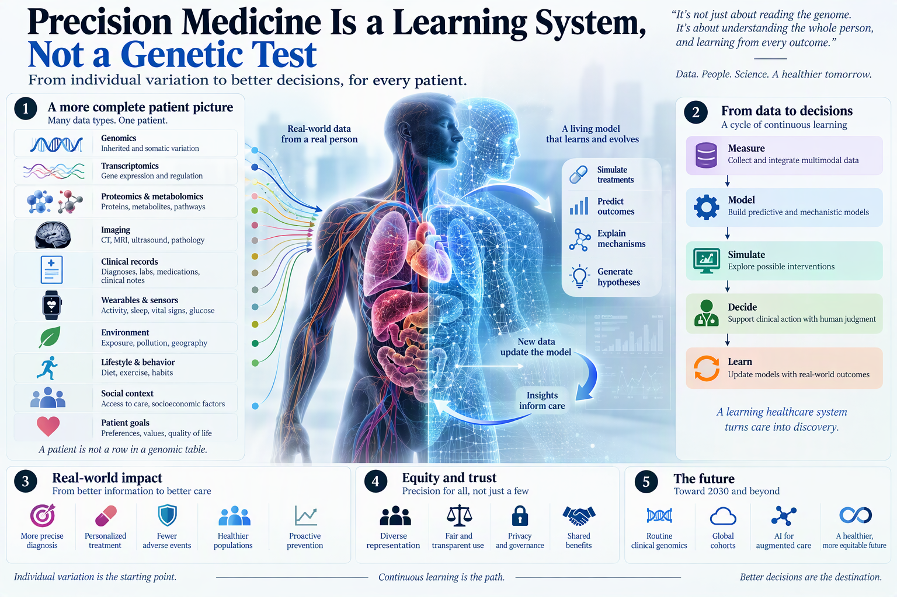

## Precision medicine has outgrown the genome
  

Precision medicine is often reduced to a familiar formula: sequence the genome, identify a variant, and match the patient to a treatment.
  

That model works in selected settings. A pathogenic variant may resolve a rare-disease diagnosis. A tumor alteration may reveal a druggable dependency. A pharmacogenomic result may change a prescription. But most clinical decisions cannot be explained by DNA alone.
  

*Precision medicine combines multiple sources of patient data with clinical decisions and ongoing learning.*

Disease emerges from interactions among inherited variation, molecular regulation, physiology, behavior, environment, treatment history, and access to care. Two patients can carry the same risk allele yet follow different clinical trajectories. Two tumors with the same driver mutation can respond differently because their cellular states, immune environments, and prior treatments are not the same.
  

Precision medicine must therefore move beyond genetic matching. Its real task is to construct a sufficiently detailed model of the patient, identify which differences matter for the decision at hand, and update that model as new evidence arrives.
  

The central object is not the genome. It is the **longitudinal patient state**.
  

## A patient is not a row in a genomic table
  

Clinical data are fragmented by design. Genomic laboratories describe variants. Imaging systems describe anatomy. Electronic health records capture diagnoses, laboratory values, medications, and clinical notes. Wearable devices measure activity, sleep, heart rhythm, or glucose outside the hospital. Environmental data describe exposures that may never appear in the medical record.
  

Each source sees a different patient.
  

Precision medicine begins when these measurements are interpreted together. A useful patient representation may include:

- germline and somatic variation;
- gene expression, proteins, metabolites, and microbiomes;
- imaging and pathology;
- laboratory and physiological measurements;
- medications and treatment history;
- symptoms and longitudinal clinical notes;
- diet, physical activity, sleep, and behavior;
- environmental and social exposures;
- patient goals and treatment preferences.
  

This is not simply a demand for more data. Additional variables can increase noise, amplify bias, and make models harder to validate. The purpose of multimodal integration is to recover the biological and clinical context that determines whether a finding is actionable.
  

A variant becomes useful when it changes diagnosis, prevention, treatment, or monitoring. A phenotype becomes useful when it distinguishes patients who require different actions. Precision is not the number of variables collected. It is the resolution at which clinically meaningful differences can be detected.
  

## Cohorts provide scale, but longitudinal data provide meaning
  

Large research cohorts have become the infrastructure of precision medicine. UK Biobank, FinnGen, the Million Veteran Program, and the All of Us Research Program connect biological measurements with clinical histories and health outcomes. International initiatives are moving toward federated analyses across tens of millions of participants rather than isolated datasets maintained by individual institutions.
  

Scale matters because many clinically important patterns are rare. A pathogenic variant may occur in only a small fraction of the population. A drug reaction may depend on an uncommon combination of genotype, medication, and comorbidity. A disease that appears uniform at the population level may separate into several mechanistically distinct subtypes once enough patients are studied.
  

But cohort size alone is not enough.
  

A large cross-sectional dataset can reveal associations without showing how disease develops, how treatment changes its course, or why one patient deteriorates while another remains stable. Precision medicine requires longitudinal observation because the clinically relevant unit is often a transition:
  

**Healthy → at risk → early disease → treated → responsive, resistant, or toxic**
  

Electronic health records can provide years of diagnoses, laboratory tests, imaging studies, prescriptions, and narrative observations. Wearables and home sensors can fill the periods between clinical encounters. Together, they shift medicine from episodic snapshots toward continuous trajectories.
  

The hardest problem is no longer simply storing data. It is aligning measurements collected at different times, under different conditions, for different purposes, and with different forms of error.
  

## AI is an inference layer, not the definition of precision
  

No clinician can manually interpret whole genomes, longitudinal records, imaging, free text, environmental exposure, and continuous sensor streams for every patient. Artificial intelligence is therefore becoming essential to precision medicine, but its role must be defined carefully.
  

AI can extract phenotypes from clinical notes, detect patterns in medical images, classify molecular profiles, prioritize genetic variants, predict treatment response, and identify patients whose trajectories differ from expected care. It can link information that would remain disconnected in conventional clinical workflows.
  

Yet a model that predicts well is not automatically practicing precision medicine.
  

A model may exploit hospital-specific documentation, reflect biased treatment histories, or learn correlations that disappear in another population. It may classify risk accurately without identifying an intervention that changes that risk. It may generate a treatment recommendation without communicating when the patient lies outside its validated domain.
  

The appropriate concept is **augmented intelligence**. Computation contributes scale, detection, and probabilistic inference. Clinicians contribute causal judgment, contextual interpretation, ethical responsibility, and communication with the patient.
  

The strongest system is neither the unaided clinician nor the autonomous model:
  

**Patient data + computational inference + clinical judgment + patient preference**
  

AI should make clinically important information visible. It should not conceal uncertainty behind an automated recommendation.
  

## Genomics becomes transformative when it becomes routine
  

Clinical genomics is still commonly ordered after a rare disease is suspected or after a patient develops a cancer for which molecular profiling may guide therapy. That sequencing model is reactive. The information is generated only after the clinical question appears.
  

A more mature system treats genomic information as durable clinical infrastructure.
  

Whole-genome data can support rare-disease diagnosis, hereditary cancer screening, cardiovascular risk assessment, pharmacogenomics, reproductive counseling, and future reinterpretation as scientific knowledge changes. The same genome does not need to be repeatedly measured, but its meaning must be repeatedly updated.
  

Pharmacogenomics illustrates the difference between possessing data and using it. Genotype-guided prescribing becomes practical only when the result is available before the drug is ordered, connected to current recommendations, and presented inside the prescribing workflow.
  

The operational chain is:
  

**Preemptive sequencing → variant interpretation → phenotype assignment → drug-specific rule → point-of-care recommendation**
  

If the result arrives after treatment begins, the precision is scientifically valid but clinically late.
  

Routine genomics also creates a reinterpretation problem. Variant classifications change, actionable gene lists expand, and new gene-drug relationships emerge. A genome-aware electronic health record must therefore treat genomic knowledge as a continuously updated layer, not a static PDF deposited in the chart.
  

## Electronic health records must become computational instruments
  

Most electronic health records were designed for documentation, billing, and communication. Precision medicine asks them to support longitudinal inference.
  

That transition requires more than adding a genomics tab. The system must integrate structured observations, narrative notes, images, molecular results, device data, and decision-support logic. Data must also move between institutions without losing meaning.
  

Interoperability standards can address part of the problem, but formatting is not the same as semantic consistency. Different hospitals measure, code, and document the same clinical state differently. Missingness may represent an unperformed test, care received elsewhere, or a clinician's judgment that the test was unnecessary.
  

Clinical data are therefore not neutral observations. They are traces of prior decisions.
  

Models trained on these traces can inherit referral patterns, insurance constraints, unequal access, and historical undertreatment. Precision medicine cannot treat the electronic health record as a transparent description of biology. It must distinguish the patient's state from the healthcare system's behavior toward that patient.
  

## Phenomics and environment complete the patient model
  

The genome is largely stable. Health is not.
  

Physical activity, nutrition, sleep, medication adherence, pollution, stress, infection, occupation, and socioeconomic conditions can modify disease risk and treatment response throughout life. Much of this information exists outside traditional clinical systems.
  

Wearable devices can provide continuous measurements of activity, heart rhythm, sleep, oxygen saturation, or glucose. Geospatial linkages can estimate environmental exposures. Digital food records, metabolomics, and microbiome measurements may support more precise models of nutrition. Patient-reported outcomes provide information that laboratory tests and imaging cannot capture.
  

These measurements deepen phenotyping, but they also create a severe interpretation problem. Continuous data are noisy, device-dependent, behaviorally confounded, and often missing in nonrandom ways. A patient who does not wear a sensor is not biologically equivalent to one whose sensor records no activity.
  

The objective is therefore not continuous surveillance for its own sake. It is to identify measurements that improve a specific clinical decision.
  

A useful phenotype is not merely detailed. It is connected to mechanism, prognosis, treatment response, or prevention.
  

## Diversity is a scientific requirement
  

Precision medicine cannot be precise when the evidence base represents only a narrow fraction of humanity.
  

Historically, genomic research and clinical trials have disproportionately represented populations of European ancestry. This creates two failures. Models can become less accurate in underrepresented groups, and biomedical discovery misses variants, exposures, and disease mechanisms that would be visible in more diverse populations.
  

The problem cannot be solved by adding race as a corrective variable.
  

Race compresses genetic ancestry, geography, culture, discrimination, environmental exposure, healthcare access, and social conditions into one unstable category. Better models should measure the relevant mechanisms more directly: ancestry when genetic structure matters, exposure when environment matters, and access or structural inequality when healthcare delivery matters.
  

Representative recruitment is only the beginning. Communities must also participate in governance, research priorities, interpretation, and benefit sharing. A dataset can be diverse while the scientific agenda remains extractive.
  

Equity is therefore not a constraint placed on precision medicine after development. It determines whether the resulting knowledge is valid.
  

## Trust is part of the infrastructure
  

Precision medicine depends on people contributing deeply personal data over long periods. Whole genomes, medical records, family histories, location traces, sensor streams, and behavioral measurements can reveal more than participants intended to disclose.
  

Technical security is necessary, but it is not sufficient.
  

People need to know who can use their data, how access is controlled, whether results will be returned, how commercial value is distributed, and what happens when a clinically important finding is discovered. They also need credible protection against reidentification and discriminatory use.
  

Federated analysis, privacy-preserving identifiers, controlled research environments, encryption, and governance can reduce risk. None of these tools can replace transparency.
  

Participation will not persist if individuals provide all of the data while institutions retain all of the value.
  

A sustainable precision-medicine system must return something meaningful: genomic results, clinically relevant findings, understandable research updates, better services, or genuine influence over governance.
  

Trust is not public relations. It is a prerequisite for data quality and scientific scale.
  

## From prediction to a learning healthcare system
  

The deepest promise of precision medicine is not one perfect algorithm or one universal biomarker. It is a healthcare system that continuously learns.
  

In such a system:

1. clinical care generates structured longitudinal evidence;
2. genomic, phenotypic, environmental, and treatment data are integrated;
3. computational models identify patterns and estimate outcomes;
4. clinicians and patients choose among available actions;
5. outcomes return to the system;
6. models, guidelines, and workflows are updated.
  

This feedback loop transforms routine care into evidence generation without pretending that every clinical observation is equivalent to a randomized experiment.
  

The distinction is crucial. Real-world data can reveal rare events, heterogeneous treatment effects, and long-term outcomes. It can also encode confounding, selection bias, and inconsistent measurement. A learning system must therefore combine observational inference with prospective studies, pragmatic trials, and deliberate validation.
  

Precision medicine fails when discovery and implementation remain separate. A genomic association in a publication has little clinical value until it is converted into a validated test, connected to an intervention, embedded in a workflow, and evaluated against patient outcomes.
  

## The real transformation
  

Precision medicine will not be delivered by genomics alone, AI alone, or larger datasets alone.
  

It requires interoperable longitudinal cohorts, diverse populations, routine clinical genomics, deep phenotyping, environmental measurement, computational inference, secure infrastructure, and decision support that fits real clinical work.
  

More importantly, these components must operate as one learning system.
  

The future of medicine is not a separate algorithm for every patient. It is a system capable of determining which differences between patients matter, which intervention those differences justify, and whether the resulting decision actually improves health.
  

**Precision medicine begins by measuring individual variation. It succeeds only when that variation changes care.**

## Sources

- Johnson, K. B. et al. *Precision Medicine, AI, and the Future of Personalized Health Care*. Clinical and Translational Science 14, 86–93 (2021). [Full text](https://pmc.ncbi.nlm.nih.gov/articles/PMC7877825/pdf/CTS-14-86.pdf)
- Denny, J. C. & Collins, F. S. *Precision Medicine in 2030: Seven Ways to Transform Healthcare*. Cell 184, 1415–1419 (2021). [Full text](https://www.cell.com/action/showPdf?pii=S0092-8674%2821%2900058-1)
