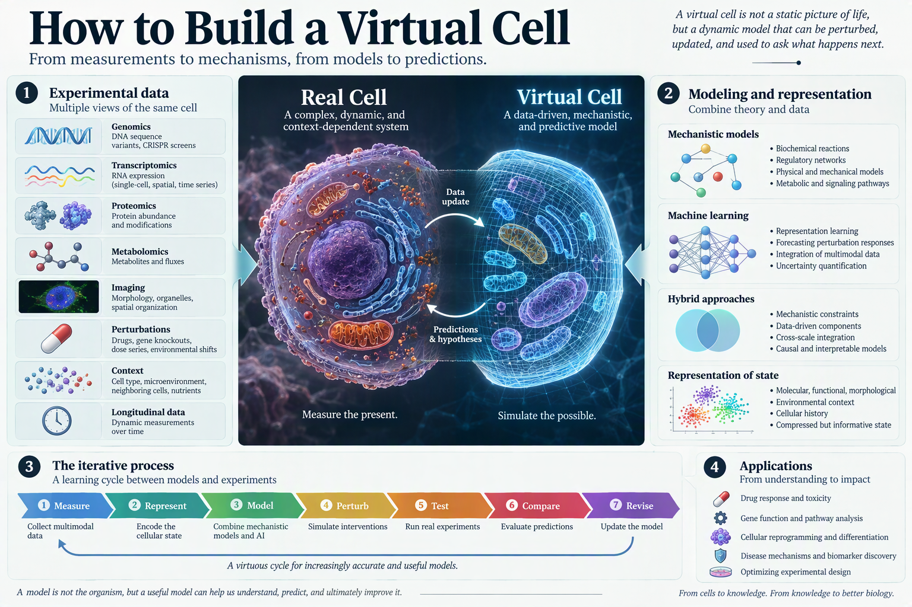

# A Virtual Cell Must Do More Than Predict

*A virtual cell is not a digital atlas, a large embedding, or a model that reconstructs gene expression. It is a testable theory of cellular response: one that predicts what a perturbation will do, explains why it happens, and directs the next experiment.*

Drug discovery is an inference problem conducted under severe uncertainty. Researchers intervene on molecules, cells, tissues, and patients, then ask whether the resulting effect will be therapeutic. The process remains expensive and failure-prone: roughly nine of every ten drugs entering clinical trials fail to receive approval. A credible computational model of treatment response would therefore have enormous value, even if it begins at the cellular rather than patient level.

A precise standard emerges for such models. A therapeutically useful virtual cell must possess three linked capabilities: **Predict, Explain, and Discover**, or **P-E-D**. Prediction without mechanism is fragile. Mechanism without intervention-level accuracy is decorative. Discovery requires both.

## Prediction means intervention, not reconstruction

The first responsibility of a virtual cell is to predict the **functional response** of a cell to a perturbation. The output is not limited to transcription. It may include changes in gene expression, protein activity, signaling, morphology, metabolism, proliferation, secretion, differentiation, or death.

*Prediction becomes useful when interventions and experimental measurements refine the model.*

This matters because drugs rarely act through a single isolated target. They alter networks, trigger feedback, create off-target effects, and produce different outcomes across cellular contexts. A model that predicts one protein-ligand interaction may be useful, but it does not yet model the cell.

The first design principle is decisive: **predict relative change**. The model should estimate how a perturbation changes a particular initial state, not generate an abstract perturbed profile in isolation. Cellular response depends on whether the target is active, which pathways are already engaged, and when the intervention occurs. The same drug can be effective, inert, or toxic depending on genotype, cell type, microenvironment, dose, and timing.

Conditioning on a matched control or basal state also offers a practical advantage. It helps separate the targeted effect from housekeeping programs, technical variation, and shared perturbation artifacts. Instead of pretending that heterogeneous datasets are perfectly harmonized, the model learns the difference between control and intervention within context.

This is a more defensible formulation of virtual-cell modeling: not "generate a cell," but **estimate the distribution of outcomes under intervention**.

## Explanation must be biological and falsifiable

Accurate prediction is necessary, but insufficient. A model that forecasts a response without identifying the process that produced it cannot reliably support counterfactual reasoning, target selection, combination design, or resistance analysis.

Here, *explanation* must mean more than conventional machine-learning explainability. Attention maps, saliency scores, and feature attributions describe model behavior. They do not necessarily explain biology. A biological explanation must provide a structured and testable account of how a perturbation changes molecular interactions and how those changes propagate into a cellular phenotype.

The authors adopt explanatory pluralism. A response may be explained mechanistically through proteins and pathways, semantically through the functional meaning of biological sequences, or structurally through graphs, embeddings, and statistical constraints. These forms are not mutually exclusive. What matters is that the explanation remains biologically actionable and experimentally falsifiable.

The second design principle follows: **explain perturbations as dynamic changes to key biomolecular interactions**. A useful explanation should identify a minimal, coherent cascade involving events such as altered binding, conformational change, post-translational modification, transcriptional regulation, or signal propagation.

This does not require an atom-by-atom simulation of the entire cell. A typical eukaryotic cell contains on the order of 100 trillion atoms, placing complete first-principles simulation beyond current computation. The practical strategy is hybrid. Top-down models learn functional responses from multimodal perturbation data; bottom-up structural models and targeted molecular simulations constrain key events. Atomistic detail is used where it changes the explanation, not where it merely increases computational cost.

This bridge between cellular observations and molecular causes is the scientific core of the proposal. A virtual cell should move in both directions: from molecular perturbation to phenotype, and from observed phenotype back to plausible mechanism.

## Discovery requires a laboratory loop

A virtual cell becomes scientifically important only when it produces knowledge that was not already encoded in its training data.

The third capability, **Discover**, reframes the model as a hypothesis engine. It should propose mechanisms, identify therapeutic vulnerabilities, prioritize interventions, and select experiments that are maximally informative. The laboratory is not merely a source of training data. It is the environment in which the model's claims are challenged.

The third design principle is **lab-in-the-loop falsification**. A virtual cell is initially trained on existing measurements. Human or artificial agents then select hypotheses, design experiments, execute them, analyze the outcomes, and update the model when its predictions fail. The objective is not to confirm the model repeatedly, but to find the experiments most likely to expose where it is wrong.

This is a sharper vision than passive model refinement. The virtual cell becomes a falsifiable theory of cellular physiology and pathology. Active learning and sequential optimization can steer experiments toward uncertain contexts, perturbation combinations, or disease-relevant mechanisms. Discovery emerges from the cycle:

**Model -> Hypothesize -> Design -> Test -> Falsify -> Update**

Extended far enough, this framework suggests a path toward scientist AI systems capable of prioritizing hypotheses, designing experiments, orchestrating laboratory execution, interpreting results, and integrating new evidence. The ambition is substantial, but the criterion remains conventional science: the system must generate claims that survive experimental contact.

## Why this is becoming plausible now

Fully mechanistic whole-cell simulation remains intractable, especially for eukaryotic systems. Four developments now create a different path forward:

1. **Modern AI and machine learning** can extract structure from high-dimensional perturbation data and integrate multiple modalities.
2. **Modern compute infrastructure** makes large-scale training and molecular modeling increasingly feasible.
3. **Automated laboratories** can generate standardized interventional data at industrial scale. Recursion's phenomics platform can obtain microscopy readouts from approximately 2.2 million samples per week.
4. **Expanding cellular datasets** now span genomics, transcriptomics, proteomics, metabolomics, phenomics, and other readouts.

These advances do not solve cellular complexity. They make it possible to learn useful approximations without waiting for a complete mechanistic account of every molecule.

The historical contrast is important. Early systems such as E-Cell and VCell encoded explicit reactions and rules. Whole-cell models later demonstrated genotype-to-phenotype prediction in relatively simple organisms, but remained labor-intensive and difficult to scale. Recent foundation-model approaches emphasize representations, multimodal embeddings, and in silico perturbation. These approaches are valuable, but the standard must be higher: a representation is not a virtual cell unless it predicts intervention effects, supports biological explanation, and contributes to experimentally validated discovery.

## The drug-discovery scope is deliberately broad

P-E-D capabilities could affect nearly every stage of therapeutic development. Virtual cells could compare healthy and diseased states, identify causal vulnerabilities, rank targets, predict essentiality and synthetic lethality, screen compounds across cellular contexts, infer mechanisms of action, explain polypharmacology, optimize selectivity and ADMET properties, anticipate resistance, discover combination therapies, identify biomarkers, and support patient stratification or dosing hypotheses.

Examples clarify the logic. A virtual cell could predict that vorinostat upregulates tumor-suppressor programs, explain the response through histone deacetylase inhibition, and propose biomarkers or combinations with DNA-damaging agents. At a higher level, a virtual patient might predict pembrolizumab response, explain it through PD-1 blockade and restored T-cell activity, then propose strategies for responsive subgroups or resistance states.

These examples expose the central claim: explanation is not an optional narrative attached after prediction. It is what enables transfer from an observed response to a new therapeutic hypothesis.

## Benchmarking is part of the model definition

A field cannot progress if its benchmarks reward the wrong behavior. Current evaluations are often dominated by transcriptomic datasets because they are large and accessible. Yet mRNA captures only part of cellular function and may not track protein activity, morphology, post-translational regulation, or phenotype. Reusing the same narrow datasets can produce impressive metrics without meaningful biological progress. Simple baselines, including average perturbation responses or established latent-variable models, may also remain unexpectedly competitive.

A credible evaluation must cover four dimensions:

- **Functional response:** multimodal changes rather than one favored assay.
- **Cellular context:** intrinsic state, genotype, cell type, assay conditions, microenvironment, and neighboring cells.
- **Perturbation diversity:** genetic, chemical, extracellular, immune, and combinatorial interventions.
- **P-E-D capability:** prediction, mechanistic explanation, and therapeutically actionable hypothesis generation.

It organizes progress into observational, contextual, and explanatory capabilities. Models should advance from predicting specific measured biology, to core cross-modal processes, to unobserved or latent biology; from intrinsic context to extrinsic context; and from single snapshots to temporal and causal accounts.

Three proposed performance levels make the ambition concrete:

- **VC Level 1:** predict and explain specific biology in intrinsic and extrinsic context at one timepoint.
- **VC Level 2:** predict and explain core biology across environmental variation and over time.
- **VC Level 3:** predict and explain unobserved biology in spatial systems with causal interpretability.

Good benchmarks should use biologically informed splits, complementary local and global metrics, statistical significance, strong simple baselines, and prospective blind evaluation. They should be updated as biological knowledge changes and distributed through reproducible, open software. In this field, benchmarking is not administrative infrastructure. It determines what researchers optimize and therefore what the term *virtual cell* comes to mean.

## From virtual cells to virtual patients

The framework extends naturally across biological scales. Interacting virtual cells could form virtual tissues; coordinated tissues could form virtual organs; integrated organs, genetics, physiology, environment, and treatment history could support virtual patients.

This hierarchy need not be built strictly from the bottom up. Organs-on-chips, in vivo omics, longitudinal biomarkers, and multimodal patient data may allow higher-order models to be learned directly. Still, the explanatory principle remains hierarchical: predictions at one level should be linked to mechanisms at the level below.

A virtual tissue must explain how cell-cell communication and spatial organization shape collective response. A virtual organ must represent anatomical structure, long-range signaling, toxicity, and compensatory dynamics. A virtual patient must predict clinical trajectories while explaining variation across individuals.

That destination remains aspirational. The more immediate objective is to define a rigorous intermediate target.

## The real test

The strongest principle is also the simplest: a virtual cell should be judged by what happens when it is wrong.

If failure leads only to a lower benchmark score, the model remains a prediction system. If failure identifies a missing interaction, motivates an experiment, revises a mechanism, and improves the next therapeutic hypothesis, the model begins to function as a scientific theory.

The field does not need another expansive biological representation marketed as a cell. It needs models that survive interventions, expose their mechanisms, admit uncertainty, and actively seek falsification. **Predict, Explain, Discover** is therefore not a slogan. It is a minimum specification for turning virtual cells from computational artifacts into instruments of drug discovery.

## Source

Noutahi, E. et al. *Virtual Cells: Predict, Explain, Discover*. arXiv:2505.14613v3 (2025).
